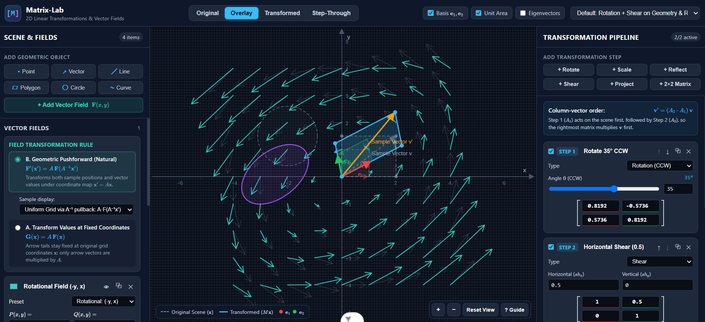

# Matrix-Lab

**Matrix-Lab** is an interactive 2D mathematical visualization web application for exploring linear transformations on geometric objects and vector fields.

- **Live Demo:** [https://pratheeshrussell.github.io/matrix-lab/](https://pratheeshrussell.github.io/matrix-lab/)
- **Repository:** [https://github.com/pratheeshrussell/matrix-lab](https://github.com/pratheeshrussell/matrix-lab)



Instead of treating linear algebra as static equations on paper, Matrix-Lab lets you construct a 2D scene of shapes, vectors, curves, and vector fields, apply an ordered pipeline of $2 \times 2$ transformation matrices, and inspect both the geometric result and the underlying mathematics in real time.

---

## Key Features

### 1. Ordered Transformation Pipeline
- **Preset & Custom $2 \times 2$ Matrices:** Add **Rotation**, **Scaling**, **Reflection** (across $x$-axis, $y$-axis, $y = x$, $y = -x$, origin, or any angle $\theta$), **Shear**, **Projection** (singular rank-1 maps), or arbitrary user-entered $2 \times 2$ matrices.
- **Interactive Manipulation:** Adjust angles and scale/shear parameters with sliders or edit the $2 \times 2$ matrix entries $\begin{bmatrix} a & b \\ c & d \end{bmatrix}$ directly.
- **Non-Commutative Pipeline Experimentation:** Reorder steps ($\uparrow / \downarrow$), enable/disable individual matrices, duplicate steps, or append the composite inverse $M^{-1}$ with one click.
- **Explicit Column-Vector Convention:** Displays the exact left-multiplication order $\mathbf{v}' = (A_n \cdots A_2 A_1)\,\mathbf{v}$ alongside the sequential step list.

### 2. First-Class Vector Field Visualization
Vector fields $\mathbf{F}(x, y) = (P(x, y), Q(x, y))$ are stored by their mathematical definition and configurable sampling grid—never as static arrows.
- **Built-in Presets & Custom Expressions:** Choose **Radial** $(x, y)$, **Rotational** $(-y, x)$, **Hyperbolic Saddle** $(x, -y)$, **Constant** $(1, 0)$, or enter custom mathematical expressions for $P(x, y)$ and $Q(x, y)$ (e.g. `sin(x)`, `-y + 0.5*x`).
- **Configurable Sampling:** Adjust grid density (`stepsX`, `stepsY`), sampling domain bounds, arrow scaling, and optional length normalization.
- **Two Explicit Transformation Semantics:**
  - **Mode A — Transform Vector Values at Fixed Coordinates:**
    $$\mathbf{G}(\mathbf{x}) = A\,\mathbf{F}(\mathbf{x})$$
    Sample positions remain fixed on the original grid while arrow vectors are multiplied by $A$.
  - **Mode B — Geometric Pushforward (Natural Coordinate Map):**
    $$\mathbf{F}'(\mathbf{x}') = A\,\mathbf{F}(A^{-1}\mathbf{x}')$$
    Both sample positions and vector values transform under $\mathbf{x}' = A\mathbf{x}$. Supports uniform target-grid pullback ($A\mathbf{F}(A^{-1}\mathbf{x}')$) as well as forward-mapped sample points ($\mathbf{x}' = A\mathbf{x},\ \mathbf{v}' = A\mathbf{F}(\mathbf{x})$), and explicitly explains when a singular matrix ($\det(A) = 0$) has no inverse $A^{-1}$.

### 3. Geometric Scene Objects
Add, inspect, hide/show, duplicate, and customize:
- **Points** $(x, y)$
- **Vectors** (tail $(x_0, y_0)$ and components $(\Delta x, \Delta y)$)
- **Line Segments & Infinite Lines**
- **Polygons & Rectangles** (editable vertex list)
- **Circles** (center & radius, rendered parametrically so shears/scales accurately produce tilted ellipses or collapsed segments)
- **Function & Parametric Curves** ($y = f(x)$ or $(x(t), y(t))$)

### 4. Visualization Modes & Mathematical Readouts
- **4 Viewing Modes:**
  - **Original:** Untransformed scene only.
  - **Overlay:** Original scene (dashed) and transformed scene (solid) together.
  - **Transformed:** Final transformed scene only.
  - **Step-Through:** Interactive stepper (`Step 0 → Step 1 → ... → Step N`) showing intermediate cumulative matrices and geometry after each step.
- **Mathematical Overlays & Analysis:**
  - **Standard Basis Vectors ($\mathbf{e}_1, \mathbf{e}_2$):** Visualizes how the columns of $M$ track $M\mathbf{e}_1$ and $M\mathbf{e}_2$, plus the unit-square area parallelogram.
  - **Matrix Properties Card:** Live readout with plain-language explanations of **Determinant** (area scale factor $|\det(M)|$ & orientation preservation/reversal), **Rank** (dimension of the image subspace), **Trace**, **Invertibility & $M^{-1}$**, and **Eigenvalues / Eigenvectors** (including real invariant direction lines on the canvas).
- **Curated Educational Experiments:** Built-in presets exploring $\det(A) = 0$ singular collapse, orientation reversal on rotational fields, non-commutativity ($B A \neq A B$), and eigenvectors.

---

## Tech Stack & Architecture

- **Framework:** Vue 3 (Composition API) + TypeScript
- **State Management:** Pinia ([sceneStore.ts](src/stores/sceneStore.ts), [transformationStore.ts](src/stores/transformationStore.ts))
- **2D Coordinate Renderer:** JSXGraph (isolated behind [Renderer.ts](src/renderers/Renderer.ts) / [JSXGraphRenderer.ts](src/renderers/JSXGraphRenderer.ts))
- **Expression Compilation:** `mathjs` (`mathjs/number` AST compiler in [ExpressionParser.ts](src/domain/math/ExpressionParser.ts))
- **Math Typesetting:** KaTeX ([KatexMath.vue](src/app/components/KatexMath.vue))
- **Build & Test:** Vite + Vitest

```text
src/
├── app/
│   ├── components/       # TopToolbar, SceneObjectsPanel, CanvasViewport, TransformationPipelinePanel, MatrixAnalysisCard
│   └── styles/           # Custom CSS variables scientific workbench theme
├── domain/
│   ├── math/             # Vector2, Matrix2, Transform, ExpressionParser
│   └── scene/            # SceneObject (GeometricSceneObject, VectorFieldSceneObject)
├── engine/               # SceneEvaluator, VectorFieldEvaluator, MatrixProperties, educationalPresets
├── renderers/            # Renderer interface & JSXGraphRenderer implementation
└── stores/               # Pinia sceneStore and transformationStore
```

---

## Getting Started

### Install Dependencies

```sh
npm install
```

### Start Development Server

```sh
npm run dev
```

### Run Unit Tests

```sh
npm run test:unit -- --run
```

### Type-Check & Build for Production

```sh
npm run build
```

---

## Deployment (GitHub Pages)

This project is pre-configured to deploy automatically to **GitHub Pages** via [`.github/workflows/deploy.yml`](.github/workflows/deploy.yml) with `base: '/matrix-lab/'` in [`vite.config.ts`](vite.config.ts).


